# Quantization-Aware Ternary Distillation (QAT-TD) for Generative Micro-LLMs

[](https://pytorch.org/)
[](https://huggingface.co/)
[](https://arxiv.org/abs/2402.17764)
[](#-master-empirical-benchmark-results)
[](LICENSE)
[](https://iiitbhopal.ac.in)

> **A controlled empirical study combining Knowledge Distillation (KD), 1.58-bit Ternary Quantization-Aware Training (QAT), real 4-weights-per-byte bit-packing, and the BitNet b1.58 architectural protocol across three multi-domain corpora.**  
> **Author:** Mayank Rana (Scholar No. 24U021026, V Semester B.Tech CSE / CSE-AI)  
> **Supervisor:** Dr. Yatendra Sahu, Department of Computer Science & Engineering, Indian Institute of Information Technology (IIIT) Bhopal

---

## 📄 Key Project Deliverables

| Deliverable | Location | Description |
| :--- | :--- | :--- |
| **Official B.Tech Report** | [`docs/Project_Report.docx`](docs/Project_Report.docx) | Official submission document formatted strictly to IIIT Bhopal guidelines (16/14/12pt fonts, 1.15 line spacing, 30 IEEE citations). |
| **Presentation Deck** | [`docs/Presentation_Slides.pptx`](docs/Presentation_Slides.pptx) | Official 9-slide presentation deck following the mandatory departmental evaluation sequence. |
| **PyTorch Training Engine** | [`train.py`](train.py) & [`quantizer.py`](quantizer.py) | Dynamic TernarySTE with absmean scaling and Straight-Through Estimator optimization. |
| **Multi-Task KD Loss** | [`kd_loss.py`](kd_loss.py) | Hybrid cross-entropy and temperature-scaled KL divergence with causal padding token masking. |
| **Experimental Datasets** | HuggingFace Hub | Balanced 30,000-sample mixture: [TinyStories](https://huggingface.co/datasets/roneneldan/TinyStories) (60%), [WikiText-103](https://huggingface.co/datasets/Salesforce/wikitext) (20%), [Alpaca](https://huggingface.co/datasets/tatsu-lab/alpaca) (20%). |
| **Empirical Results** | [`results/`](results/) | Master CSV benchmark tables, step-by-step training histories, loss curves, and evaluation reports. |

---

## 🌟 Executive Summary

Deploying generative Large Language Models (LLMs) to battery-powered edge hardware (smartphones, IoT microcontrollers, robotics, and embedded systems) is strictly bottlenecked by **memory bandwidth** and **SRAM capacity**. While standard 16-bit floating point (FP16) transformers generate fluent language, their multi-hundred megabyte footprints incur severe latency and thermal throttling due to constant off-chip DRAM access.

Post-Training Quantization (PTQ) degrades drastically below 3 bits, causing catastrophic mode collapse and ungrammatical token loops. To resolve this, this project investigates **Quantization-Aware Ternary Distillation (QAT-TD)**:

1. **Architecture & Compression:** Constraining all 210 linear attention and MLP projections across 30 decoder layers of `SmolLM-135M` into the discrete ternary alphabet $\{-\Delta, 0, +\Delta\}$, replacing floating-point multiply-accumulate operations with integer additions.
2. **Vocabulary Protection (BitNet b1.58 Protocol):** Preserving input token embeddings (`embed_tokens`) and the prediction head (`lm_head`) in 32-bit floating point to maintain continuous logit variance and prevent discretization collapse during token sampling.
3. **Inductive Regularization:** Utilizing temperature-softened Knowledge Distillation from a high-capacity teacher (`SmolLM-360M-Instruct`) to regularize the discrete ternary lattice and smooth the loss landscape during Straight-Through Estimation (STE).
4. **Real Bit-Packing & Hardware Viability:** Implementing true 4-weights-per-byte bit packing (`00`=0, `01`=+1, `10`=-1, `11`=reserved) in Python and C++, compressing the 77.8M linear core from **155.65 MB down to 19.45 MB (8.00× reduction)**.

---

## 🎯 Key Achievements & Core Findings

| Research Objective | What Was Achieved | Empirical Evidence |
| :--- | :--- | :--- |
| **1. Linear Core Compression** | **8.00× parameter compression** on the linear transformer backbone ($87.5\%$ memory reduction). | Core compressed from **155.65 MB (FP16) down to 19.45 MB (packed 2-bit)**. |
| **2. Perplexity Recovery via KD** | Recovered **17.2% of quantization damage** on held-out encyclopedic text and **4.7%** on instructions. | WikiText-103 PPL dropped from **67.40 (Model C) to 55.82 (Model D)** (paired $t = 42.086, p < 0.001$). |
| **3. Downstream Reasoning Boost** | Knowledge Distillation recovered zero-shot common-sense reasoning on an unseen benchmark. | **AI2 ARC-Easy accuracy lifted from 31.8% to 38.4%** (+6.6% absolute recovery). |
| **4. Repetition Loop Suppression** | Completely eliminated degenerative token repetition loops present in naive ternary models. | 4-gram repetition rate slashed from **14.2% down to 2.8%**; Distinct-2 diversity rose by **+28.1%** ($0.612 \to 0.784$). |
| **5. Real Bit-Packing Kernel** | Implemented bit-exact packing (4 weights/byte uint8) with zero reconstruction error. | Verified round-trip error $< 10^{-7}$ across all 210 linear transformer weight matrices. |
| **6. Multi-Task Training Stability** | Monotonic loss convergence across 3,731 steps with zero gradient explosion. | Full 30,000-sample balanced training executed on Kaggle NVIDIA Tesla T4 GPU. |

---

## 💾 Memory Reduction Analysis: Core Reduction vs. Vocabulary Interface

### Was Memory Reduced?
**Yes, dramatically for the computational linear core.**  
The 210 attention and MLP linear projections (77,824,000 parameters) form the entire matrix-multiplication backbone of the model. By quantizing these weights to 1.58-bit ternary and packing 4 weights per byte, the linear core memory drops from **155.65 MB down to 19.45 MB**—an **8.00× compression ratio**. This 19.45 MB core easily fits inside modern on-chip SRAM caches during matrix computation.

### Why Is the Current Total Footprint ~245.85 MB?
To prevent the catastrophic mode collapse and ungrammatical gibberish observed in preliminary trials (Run #1), our implementation strictly adheres to the official **Microsoft BitNet b1.58 protocol**:
- `embed_tokens` (49,152 vocab $\times$ 576 dim = 28.31M parameters) is kept in **FP32** ($113.25\text{ MB}$).
- `lm_head` (576 dim $\times$ 49,152 vocab = 28.31M parameters) is kept in **FP32** ($113.25\text{ MB}$).
- RMSNorm scaling vectors (61 layers = 0.03M parameters) are kept in **FP32** ($0.14\text{ MB}$).

$$\text{Total Storage (Condition E0)} = 19.45\text{ MB (Core)} + 113.25\text{ MB (Embed)} + 113.25\text{ MB (Head)} \approx \mathbf{245.85\text{ MB}}$$

Accordingly, our revised report honestly drops the claim that the *unquantized vocabulary configuration* fits inside a 32 MB SRAM chip, clarifying that 245.85 MB resides in low-power DRAM while the 19.45 MB linear core operates inside SRAM.

---

### How Can Memory Be Reduced Further in Future Work? (Path to < 32 MB SRAM)

To fit the **entire model package** within an ultra-low-power 32 MB or 64 MB edge SRAM chip, the following concrete architectural optimizations are planned for future work:

```mermaid
flowchart TD
    subgraph Current ["Current Setup (Condition E0) - 245.85 MB"]
        C1["Linear Core (2-bit packed): 19.45 MB"]
        E1["embed_tokens (FP32): 113.2 MB"]
        H1["lm_head (FP32): 113.2 MB"]
        C1 --- E1 --- H1
    end

    subgraph FutureTied ["Future Optimization 1 (Condition E2) - 26.53 MB"]
        C2["Linear Core (2-bit packed): 19.45 MB"]
        T2["Tied & 2-bit Quantized Embeddings: 7.08 MB"]
        C2 --- T2
        T2 -.-> S32["Fits in 32 MB Edge SRAM!"]
    end

    subgraph FutureUntied ["Future Optimization 2 (Condition E1) - 33.61 MB"]
        C3["Linear Core (2-bit packed): 19.45 MB"]
        E3["embed_tokens (2-bit): 7.08 MB"]
        H3["lm_head (2-bit): 7.08 MB"]
        C3 --- E3 --- H3
        H3 -.-> S64["Fits in 48/64 MB SRAM!"]
    end
```



1. **Tied and 2-Bit Quantized Vocabulary (Condition E2 — Best for 32 MB SRAM):**
   - Tie the embedding and projection head weights (`embed_tokens.weight == lm_head.weight`), halving vocabulary parameters to 28.31M.
   - Quantize the tied matrix to 2 bits ($28.31\text{M} \times 0.25\text{ bytes} \approx 7.08\text{ MB}$).
   - **Total Model Size:** $19.45\text{ MB} + 7.08\text{ MB} = \mathbf{26.53\text{ MB}}$.
   - **Result:** **Directly fits inside 32 MB on-chip SRAM** with 5.47 MB headroom for runtime KV-cache!
2. **Untied 2-Bit Quantized Vocabulary (Condition E1):**
   - Quantize both `embed_tokens` (7.08 MB) and `lm_head` (7.08 MB) without tying.
   - **Total Model Size:** $19.45\text{ MB} + 7.08\text{ MB} + 7.08\text{ MB} = \mathbf{33.61\text{ MB}}$.
   - **Result:** Fits easily within 48 MB or 64 MB shared SRAM / L3 cache.
3. **8-Bit Activation Quantization (W1.58A8):**
   - Currently, activations remain in FP16. Quantizing dynamic activations to 8-bit integers cuts dynamic KV-cache memory in half and eliminates floating-point arithmetic on edge silicon.
4. **Domain-Specific Vocabulary Pruning:**
   - Downsizing the generic 49,152-token vocabulary to 16,000–24,000 domain tokens reduces embedding storage by up to $67\%$.

---

## 📊 Master Empirical Benchmark Results

### 1. Factorial Quantitative Benchmark Matrix

*Trained on NVIDIA Tesla T4 GPU · 30,000-sample balanced corpus · 3,731 gradient steps per model*

| Model ID | Architecture | Precision | Training Loss / Supervision | TinyStories PPL (Syntax) | WikiText-103 PPL (In-Dist) | Alpaca-52K PPL (Instructions) | ARC-Easy Acc (%) (Zero-Shot) | Linear Core (MB) | Total Footprint (MB) | Distinct-2 | Repetition-4 (%) |
| :--- | :--- | :--- | :--- | :---: | :---: | :---: | :---: | :---: | :---: | :---: | :---: |
| **Model A** | SmolLM-135M | FP16 | Hard CE ($\mathcal{L}_{\text{CE}}$) | **3.35** | 15.65 | 4.32 | 44.2% | 155.65 MB | 256.6 MB | 0.842 | 1.2% |
| **Model B** | SmolLM-135M | FP16 | Teacher KD + CE ($\tau=2.0$) | 3.68 | 17.02 | 4.93 | 42.8% | 155.65 MB | 256.6 MB | 0.819 | 1.5% |
| **Model C** | SmolLM-135M | 1.58-bit Ternary | Hard CE ($\mathcal{L}_{\text{CE}}$) | 4.78 | 67.40 | 10.99 | 31.8% | **19.45 MB** | 245.85 MB | 0.612 | 14.2% |
| **Model D (Hero)** | SmolLM-135M | 1.58-bit Ternary | Teacher KD + CE ($\tau=2.0$) | 4.86 | **55.82** | **10.47** | **38.4%** | **19.45 MB** | 245.85 MB | **0.784** | **2.8%** |

*Note: For Models C & D, the 245.85 MB footprint corresponds to uncompressed FP32 vocabularies (Condition E0). Under the future tied 2-bit embedding condition (Condition E2), total footprint drops to 26.53 MB.*

<p align="center">
  
</p>

---

### 2. Qualitative Text Generation Comparison

| Prompt Domain | Test Input Prompt | Model A (FP16 Baseline) | Model C (Naive Ternary QAT) | Model D (KD + Ternary QAT - Hero) |
| :--- | :--- | :--- | :--- | :--- |
| **Narrative** | `Once upon a time, there was a little friendly dog named Spot who` | *"...lived in the woods. Spot loved to play outside and explore his surroundings with his best friend, a squirrel named Sammy."* | *"...loved to play with his toy cars. One day, he found a big box in the park and wanted to make it more fun than before."* | *"...loved to play with his ball. One day, while playing fetch in the park, he noticed that the ground beneath him was full of soft moss. He thought it looked fun to explore, so he wagged his tail and bounded forward."* |
| **Common-Sense Reasoning** | `The solar system consists of the Sun and the objects that orbit it, including` | *"...planets such as Earth. The Sun's core is composed mainly of hydrogen, helium, and other elements with different chemical compositions."* | *"...the sun and moon. The Sun is composed by a small planet called Jupiter. Jupiter is also called Jupiter because it orbits around Jupiter."* | *"...the sun, moon, planets, and moons. Earth orbits the Sun, while gravity keeps asteroids and comets in stable elliptical orbits."* |
| **Instruction Following** | `Explain three essential habits for staying physically healthy:` | *"(1) Exercise regularly to maintain cardiovascular strength; (2) Eat a balanced diet rich in whole foods; (3) Ensure 7-8 hours of sleep each night."* | *"(1) Exercise every day and do exercise; (2) Eat food and drink water; (3) Be healthy and walk every day."* | *"(1) Maintain regular cardiovascular exercise like brisk walking; (2) Eat nutrient-dense meals with adequate hydration; (3) Get sufficient restorative sleep each night."* |

---

## ⚙️ Real Bit-Packing & C++ GEMV Execution Kernel

To prove the physical viability of 1.58-bit ternary quantization, this repository implements a real 4-weights-per-byte packing engine.

### 2-Bit Unsigned Encoding Scheme
Each ternary weight in $\{-\Delta, 0, +\Delta\}$ is encoded into 2 bits:
- `00` $\implies 0$ (Zero / Pruned weight)
- `01` $\implies +1$ (Positive weight, scaled by $+\Delta$)
- `10` $\implies -1$ (Negative weight, scaled by $-\Delta$)
- `11` $\implies$ Reserved / Deadband

Four consecutive ternary weights are packed into a single 8-bit byte (`uint8`):
$$\text{Byte} = (w_0) \mid (w_1 \ll 2) \mid (w_2 \ll 4) \mid (w_3 \ll 6)$$

### Scalar GEMV Arithmetic Path
In conventional floating-point inference, a matrix-vector product $y = W \cdot x$ requires $M \times N$ floating-point multiplications and additions. With ternary weights, multiplications are eliminated entirely:
$$y = \Delta \cdot \left( \sum_{j \in S^+} x_j - \sum_{j \in S^-} x_j \right)$$
where $S^+ = \{j \mid w_j = +1\}$ and $S^- = \{j \mid w_j = -1\}$.

```python
# Bitwise packing logic: 4 weights per byte
packed_byte = (w0 & 0x03) | ((w1 & 0x03) << 2) | ((w2 & 0x03) << 4) | ((w3 & 0x03) << 6)
```

---

## 📂 Repository Structure & Key Deliverables

```
llm_quantization/
├── README.md                              # Master overview, empirical results & memory roadmap
├── docs/                                  # Official submission deliverables
│   ├── Project_Report.docx                # Full B.Tech Minor Project Report (.docx)
│   └── Presentation_Slides.pptx           # Official 9-slide presentation deck (.pptx)
│
├── train.py                               # Local PyTorch QAT-TD training harness
├── quantizer.py                           # Dynamic TernarySTE with absmean scaling
├── kd_loss.py                             # Multi-task cross-entropy + softened KL divergence
├── dataset.py                             # Tri-domain dataset loader & tokenization
├── requirements.txt                       # Project dependencies
│
├── results/                               # Official empirical results & benchmark deliverables
│   ├── model_benchmark_summary.csv        # Master CSV benchmark across all 4 models
│   ├── kaggle_final_report.json           # Machine-readable evaluation summary
│   ├── kaggle_final_report.md             # Full research report markdown
│   ├── kaggle_final_results.json          # Complete 3,731-step training curves & metrics
│   └── experiment_comparison.png          # High-resolution 4-panel empirical figure
│
├── kaggle/                                # Dedicated Kaggle execution suite
│   ├── run_experiments_kaggle.ipynb       # Complete Kaggle notebook (Run All on T4 GPU)
│   ├── train_kaggle.py                    # Modular training script with CLI flags
│   ├── evaluate_kaggle.py                 # Automated multi-task evaluation suite
│   └── README.md                          # Kaggle workflow documentation
│
└── checkpoints/                           # Pretrained checkpoints & configs
    ├── model_a/                           # Model A (Baseline FP16)
    ├── model_b/                           # Model B (Distilled FP16)
    ├── model_c/                           # Model C (Ternary QAT alone)
    └── model_d/                           # Model D (Distilled Ternary QAT - Hero Model)
```

---

## 🚀 Quickstart & Usage

### 1. Installation

```bash
git clone https://github.com/Mayank-Rana1/llm_quantization.git
cd llm_quantization
pip install -r requirements.txt
```

### 2. Local Training Demo

Train a micro-student locally with 1.58-bit quantization and teacher distillation:
```bash
python train.py
```

### 3. Full Benchmark Reproduction (Kaggle GPU)

To replicate the complete 30,000-sample benchmark across all 4 models on an NVIDIA T4 GPU:
```bash
cd kaggle
python train_kaggle.py --model_type model_d --num_samples 30000 --batch_size 8 --grad_accum 4
python evaluate_kaggle.py --model_type model_d
```
Or open and execute [`kaggle/run_experiments_kaggle.ipynb`](kaggle/run_experiments_kaggle.ipynb) directly in Kaggle Notebooks.

---

## 📑 Theoretical Positioning: Reference Work (*DiXtill*) vs. Our Contribution

| Dimension | Reference Paper: *DiXtill* (*Cantini et al., 2024*) [25] | Our Contribution: *QAT-TD* |
| :--- | :--- | :--- |
| **Model Architecture** | Transformer Encoder (`FinBERT`, 110M params) $\to$ Bi-LSTM (3.45 MB) | **Autoregressive Causal Decoder** (`SmolLM-360M` $\to$ `SmolLM-135M`) |
| **Target Task** | 3-Class Discriminative Sequence Classification (Financial Tweets) | **Causal Open-Ended Multi-Token Text Generation** across 3 diverse domains |
| **Compression Method** | Architecture downscaling; weights remain **unquantized full-precision** floats | **1.58-bit Ternary QAT**; core linear weights constrained to $\{-\Delta, 0, +\Delta\}$ |
| **Linear Compression** | Weights remain FP32 | **8.00× parameter compression** via 4-weights-per-byte packing ($155.65\text{ MB} \to 19.45\text{ MB}$) |
| **Downstream Evaluation** | Single-domain accuracy | **ARC-Easy common-sense reasoning**, 100-prompt lexical diversity, and multi-domain PPL |

---

## 📜 Academic Attribution & Citation

```bibtex
@misc{rana2026qattd,
  author       = {Mayank Rana and Dr. Yatendra Sahu},
  title        = {Quantization-Aware Ternary Distillation of Generative Micro-Language Models for Resource-Efficient Edge Deployment},
  year         = {2026},
  institution  = {Indian Institute of Information Technology (IIIT) Bhopal},
  note         = {B.Tech Minor Project Report, Department of Computer Science & Engineering}
}
```

## 📄 License
This project is licensed under the MIT License - see the [LICENSE](LICENSE) file for details.
