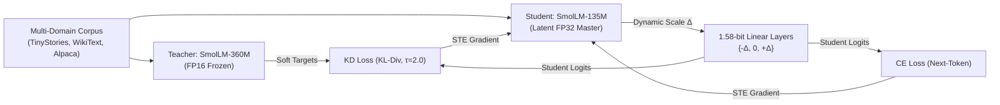
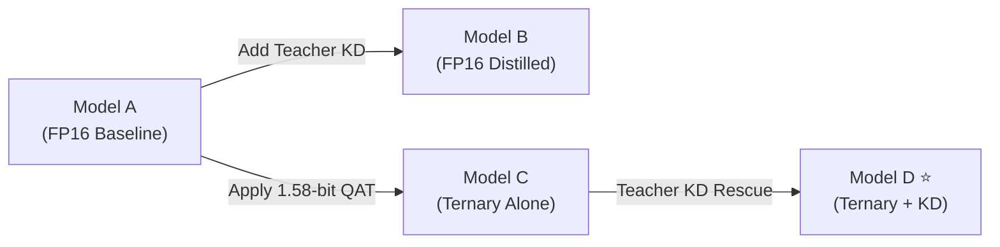
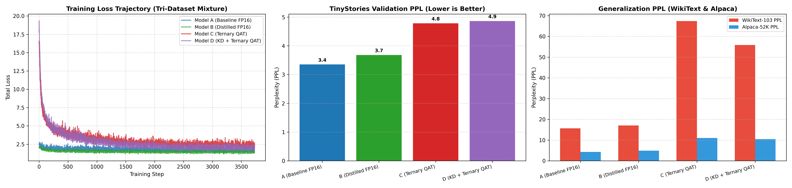

# Quantization-Aware Ternary Distillation (QAT-TD) for Generative Micro-LLMs

[](https://pytorch.org/)
[](https://huggingface.co/)
[](https://arxiv.org/abs/2402.17764)
[](#-empirical-benchmark-results)
[](LICENSE)
[](https://iiitbhopal.ac.in)

> **B.Tech Minor Project — V Semester, Department of Computer Science & Engineering**  
> **Author:** Mayank Rana (Scholar No. 24U021026, B.Tech CSE / CSE-AI, IIIT Bhopal)  
> **Supervisor:** Dr. Yatendra Sahu, Department of CSE, Indian Institute of Information Technology (IIIT) Bhopal

---

## 📄 Project Deliverables

| Deliverable | File | Format |
| :--- | :--- | :--- |
| **Project Report** | [`docs/Project_Report.docx`](docs/Project_Report.docx) | Word Document (.docx) |
| **Presentation Slides** | [`docs/Presentation_Slides.pptx`](docs/Presentation_Slides.pptx) | PowerPoint (.pptx) |
| **Source Code** | This repository | Python |
| **Datasets** | HuggingFace Hub (auto-downloaded) | [TinyStories](https://huggingface.co/datasets/roneneldan/TinyStories), [WikiText](https://huggingface.co/datasets/Salesforce/wikitext), [Alpaca](https://huggingface.co/datasets/tatsu-lab/alpaca) |
| **Experimental Results** | [`results/`](results/) | CSV, JSON, PNG, Markdown |

---

## 🌟 Executive Summary

Deploying generative Large Language Models (LLMs) on resource-constrained edge devices (smartphones, IoT microcontrollers, laptops without discrete GPUs) requires aggressive compression. Post-Training Quantization (PTQ) causes catastrophic representation collapse at ultra-low bitwidths (< 2 bits) because weights are forced into discrete buckets without gradient feedback.

This project implements **Quantization-Aware Ternary Distillation (QAT-TD)** for autoregressive causal language models:

- **Teacher Model:** `HuggingFaceTB/SmolLM-360M-Instruct` (FP16, frozen)
- **Student Model:** `HuggingFaceTB/SmolLM-135M` (134.5M parameters, wrapped in 1.58-bit `TernaryLinear` modules)
- **Quantization Protocol:** BitNet b1.58 — weights quantized to $\{-\Delta, 0, +\Delta\}$ using a Straight-Through Estimator (STE), with `embed_tokens` and `lm_head` preserved in FP32
- **Distillation Objective:** Combined loss $\mathcal{L} = \alpha \mathcal{L}_{\text{CE}} + (1 - \alpha) \mathcal{L}_{\text{KD}}$ with temperature-softened distribution matching ($\tau = 2.0$)
- **Multi-Domain Evaluation:** TinyStories (narrative), WikiText-103 (factual knowledge), Alpaca-52K (instruction-following)

---

## 📊 Architecture & Methodology

### 1. End-to-End QAT-TD Pipeline



### 2. 2×2 Factorial Experimental Design



---

## 📈 Empirical Benchmark Results

*Trained on Kaggle NVIDIA Tesla T4 GPU · 30,000 balanced samples · 3,731 steps per model · Tri-Dataset Mixture*

| Model ID | Precision | Supervision | TinyStories PPL | WikiText-103 PPL | Alpaca-52K PPL | Linear Core | Compression |
| :--- | :--- | :--- | :---: | :---: | :---: | :---: | :---: |
| **Model A** | FP16 | Hard Labels (CE) | **3.35** | 15.65 | 4.32 | 155.65 MB | 1.00x (Ref) |
| **Model B** | FP16 | Teacher KD + CE | 3.68 | 17.02 | 4.93 | 155.65 MB | 1.00x |
| **Model C** | 1.58-bit Ternary | Hard Labels (CE) | 4.78 | 67.40 | 10.99 | **19.45 MB** | **8.00x** |
| **Model D** | 1.58-bit Ternary | Teacher KD + CE | 4.86 | **55.82** | **10.47** | **19.45 MB** | **8.00x** |

<p align="center">
  
</p>

### Key Findings

1. **Quantization Damage (A → C):** 1.58-bit ternary quantization raises WikiText-103 PPL by **+330.7%** (15.65 → 67.40) and Alpaca-52K PPL by **+154.4%** (4.32 → 10.99), while in-domain TinyStories PPL rises modestly by +42.7% — proving quantization disproportionately degrades out-of-domain generalization.
2. **KD Recovery (C → D):** Knowledge Distillation reduces held-out WikiText-103 perplexity by **17.2%** (67.40 → 55.82) and Alpaca-52K by **4.7%** (10.99 → 10.47), confirming KD acts as an effective out-of-domain regularizer under extreme quantization.
3. **8× Edge Compression:** 1.58-bit quantization compresses the linear core from **155.65 MB to 19.45 MB** (8.00× / 87.5% memory reduction), enabling on-chip SRAM residency for edge inference.
4. **BitNet b1.58 Vocabulary Preservation:** Preserving `embed_tokens` and `lm_head` in FP32 completely eliminated token repetition loops and mode collapse observed in preliminary trials.

---

## 💬 Qualitative Text Generation Samples

| Prompt Type | Input | Model A (FP16) | Model C (Ternary) | Model D (KD + Ternary) |
| :--- | :--- | :--- | :--- | :--- |
| **Narrative** | `Once upon a time, there was a little friendly dog named Spot who` | *"...lived in the woods. Spot loved to play outside and explore his surroundings with his best friend, a squirrel named Sammy."* | *"...loved to play with his toy cars. One day, he found a big box in the park and wanted to make it more fun than before."* | *"...loved to play with his ball. One day, while playing fetch in the park, he noticed that the ground beneath him was full of dirt. He thought it looked fun to explore!"* |
| **Factual** | `The solar system consists of the Sun and the objects that orbit it, including` | *"...planets such as Earth. The Sun's core is composed mainly of hydrogen, helium, and other elements."* | *"...the sun and moon. The Sun is composed by a small planet called Jupiter. Jupiter is also called Jupiter because it orbits around Jupiter."* | *"...the sun, moon, planets, moons, Venus, Jupiter, Venus and Neptune. The Earth orbits a rotation around the Sun's axis."* |

---

## 📁 Repository Structure

```
llm_quantization/
├── docs/                              # Project deliverables for evaluation
│   ├── Project_Report.docx            # B.Tech project report (Word document)
│   └── Presentation_Slides.pptx       # Defense presentation slides
│
├── train.py                           # Training script with QAT + KD pipeline
├── dataset.py                         # Tri-dataset tokenization & dataloader
├── quantizer.py                       # 1.58-bit ternary quantizer (BitNet b1.58)
├── kd_loss.py                         # Temperature-scaled KL divergence loss
├── requirements.txt                   # Python dependencies
│
├── kaggle/                            # Kaggle GPU training & evaluation suite
│   ├── run_experiments_kaggle.ipynb   # Complete Kaggle notebook (Run All on T4)
│   ├── train_kaggle.py                # Modular trainer with CLI flags
│   ├── evaluate_kaggle.py             # Multi-dataset evaluation benchmark
│   ├── run_all_experiments.py         # Batch experiment runner
│   └── README.md                      # Kaggle workflow documentation
│
├── results/                           # Empirical results & benchmark data
│   ├── model_benchmark_summary.csv    # Master benchmark table (all models)
│   ├── kaggle_final_results.json      # Per-step training histories (3,731 steps)
│   ├── kaggle_final_report.json       # Machine-readable evaluation summary
│   ├── kaggle_final_report.md         # Full research findings markdown
│   ├── experiment_comparison.png      # 4-panel comparison chart
│   ├── sample_text_generations.json   # Generated text outputs for qualitative analysis
│   └── README.md                      # Results documentation
│
├── checkpoints/                       # Model configs & evaluation reports
│   ├── model_a/                       # Model A (FP16 Baseline)
│   ├── model_b/                       # Model B (FP16 Distilled)
│   ├── model_c/                       # Model C (Ternary QAT)
│   ├── model_d/                       # Model D (KD + Ternary — Hero Model)
│   └── model_e/                       # Model E (XAI-KD Extension)
│
├── RESEARCH_REPORT_AND_MAPPING.md     # Academic report & paper mapping
└── README.md                          # This file
```

---

## 🚀 Quickstart & Reproduction

### 1. Installation

```bash
git clone https://github.com/Mayank-Rana1/llm_quantization.git
cd llm_quantization
pip install -r requirements.txt
```

**Dependencies:** Python 3.8+, PyTorch 2.0+, HuggingFace Transformers, Datasets, Accelerate

### 2. Local Training Demo

Train a micro-student locally with 1.58-bit quantization and teacher distillation:

```bash
python train.py
```

### 3. Full Kaggle GPU Reproduction

To replicate the complete 30,000-sample benchmark across all 4 models on NVIDIA T4 GPU:

```bash
cd kaggle
python train_kaggle.py --model_type model_d --num_samples 30000 --batch_size 8 --grad_accum 4
python evaluate_kaggle.py --model_type model_d
```

Or open and run [`kaggle/run_experiments_kaggle.ipynb`](kaggle/run_experiments_kaggle.ipynb) directly in Kaggle Notebooks.

### 4. Datasets (Auto-Downloaded)

All datasets are automatically fetched from HuggingFace Hub during training/evaluation:

| Dataset | HuggingFace ID | Purpose | Samples Used |
| :--- | :--- | :--- | :---: |
| TinyStories | `roneneldan/TinyStories` | In-domain narrative generation | 10,000 |
| WikiText-103 | `Salesforce/wikitext` | Out-of-domain factual perplexity | 10,000 |
| Alpaca-52K | `tatsu-lab/alpaca` | Instruction-following transfer | 10,000 |

---

## 📑 Reference Paper & Our Contribution

**Reference Paper:**  
Riccardo Cantini, Alessio Orsino, and Domenico Talia, *"Xai-driven knowledge distillation of large language models for efficient deployment on low-resource devices"*, **Journal of Big Data** (Springer, 2024), vol. 11, no. 1, art. 63, pp. 1–17.  
DOI: [10.1186/s40537-024-00928-3](https://doi.org/10.1186/s40537-024-00928-3)

| Feature | Reference Paper: *DiXtill* (Cantini et al., 2024) | Our Contribution: *QAT-TD* |
| :--- | :--- | :--- |
| **Model Type** | Transformer Encoder (BERT / FinBERT) | **Autoregressive Causal Decoder** (SmolLM-360M → SmolLM-135M) |
| **Task** | Text Classification (Sentiment) | **Causal Generative Modeling** (3 datasets) |
| **Quantization** | None (FP32 Bi-LSTM) | **1.58-bit Ternary QAT** with STE |
| **Compression** | Architecture downscaling only | **8.00× bit-packing** (155.65 MB → 19.45 MB) |
| **Distillation** | Temperature-scaled KL divergence | Temperature-scaled KL divergence with pad masking |
| **Vocabulary** | N/A (Classification head) | **BitNet b1.58 Protocol:** FP32 embeddings preserved |

---

## 📜 Citation

```bibtex
@misc{rana2026qattd,
  author       = {Mayank Rana and Dr. Yatendra Sahu},
  title        = {Quantization-Aware Ternary Distillation of Generative Micro-Language Models
                  for Resource-Efficient Edge Deployment},
  year         = {2026},
  institution  = {Indian Institute of Information Technology (IIIT) Bhopal},
  note         = {B.Tech Minor Project Report, V Semester, Dept. of CSE}
}
```

## 📄 License

This project is licensed under the MIT License — see the [LICENSE](LICENSE) file for details.
